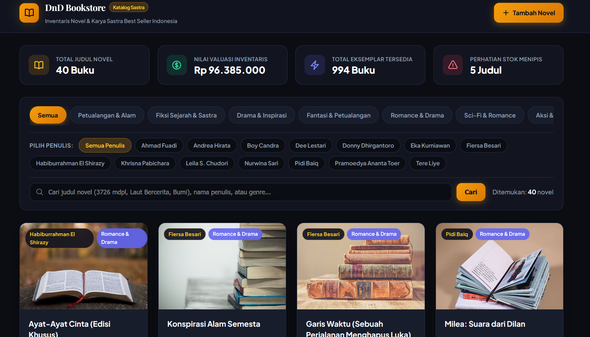
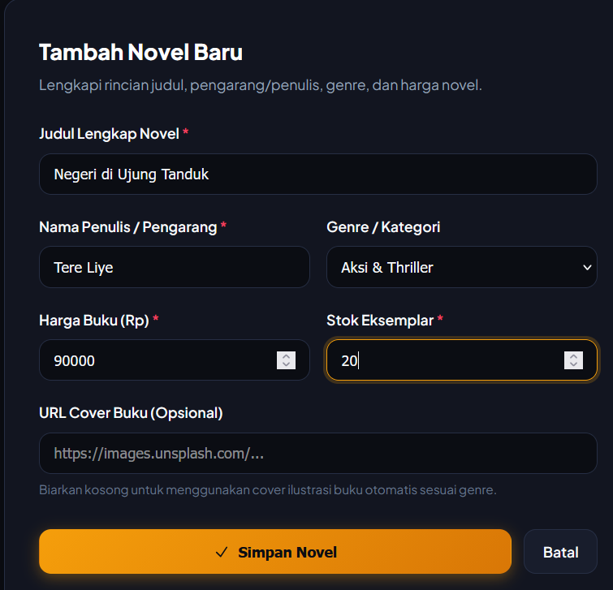
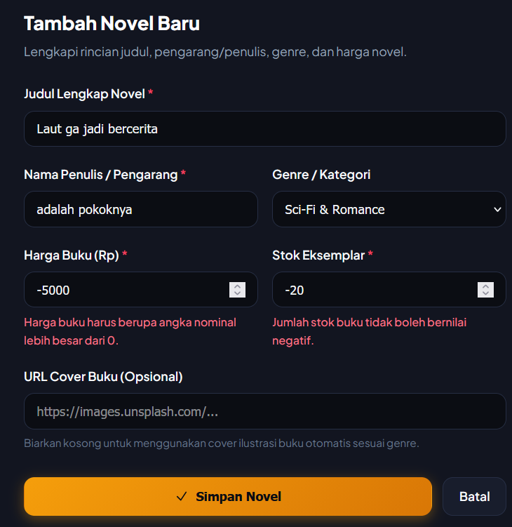
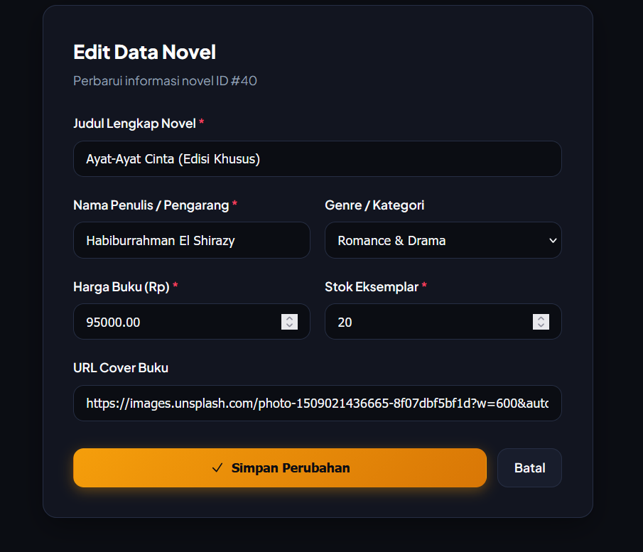
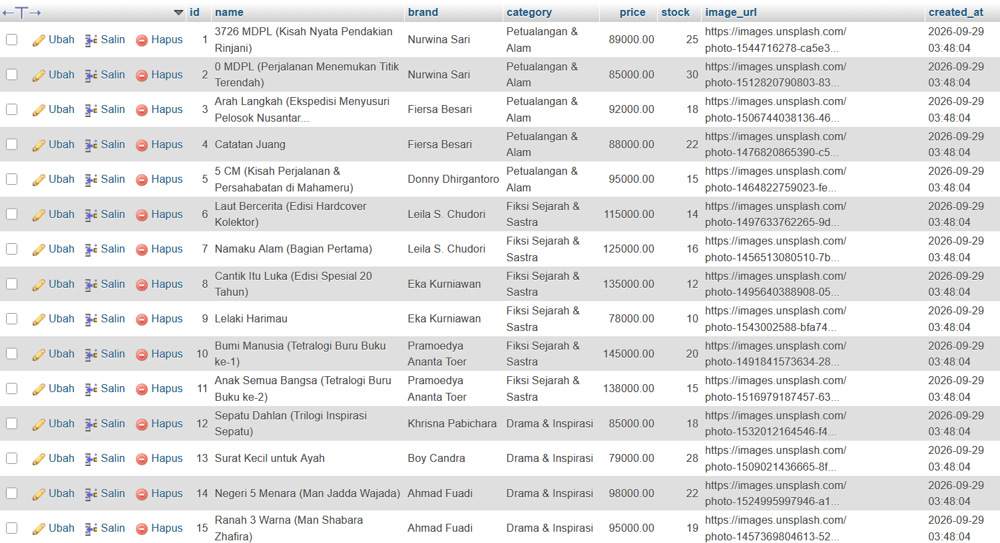

# 📚 DnD Bookstore: Indonesian Bestseller Novel Management

> **Praktikum Pemrograman Web (Pertemuan 3 — Mini Project 2)**  
> Sistem Manajemen Katalog & Inventaris Novel Asli Best Seller Indonesia berbasis **PHP Native**, **MySQL (PDO)**, dan **Responsive CSS Modern**.

---

## 📋 Informasi Proyek

| Kategori | Spesifikasi |
| :--- | :--- |
| **Mata Kuliah** | Pemrograman Web (Pertemuan 3 — Mini Project 2) |
| **Topik Praktikum** | Integrasi PHP, MySQL & UI Styling (CRUD + Web Security) |
| **Tema Aplikasi** | Katalog & Inventaris Toko Novel Sastra Best Seller Indonesia |
| **Arsitektur** | Server-Side Processing (Separation of Concerns / SoC) |
| **Engine / Stack** | PHP Native + MySQL via PDO (Tanpa Framework) |
| **Tampilan / UI** | Warm Literary Dark Theme, Flexbox Layout, Responsive Grid |

---

## 🎯 Ikhtisar & Tujuan Proyek

Aplikasi **DnD Bookstore** dirancang sebagai sistem manajemen inventaris toko buku sastra Indonesia. Sistem ini mengelola karya-karya novel legendaris dan best seller asli Indonesia, mulai dari seri petualangan alam (*3726 MDPL*, *0 MDPL*, *5 CM*), sastra bersejarah (*Laut Bercerita*, *Cantik Itu Luka*, *Bumi Manusia*), hingga serial fantasi dunia paralel karya Tere Liye (*Bumi*, *Bulan*, *Matahari*, *Bintang*, dll).

Seluruh sistem dibangun dengan standar arsitektur aman, mencakup proteksi SQL Injection, Cross-Site Scripting (XSS), Cross-Site Request Forgery (CSRF), serta alur request PRG (*Post-Redirect-Get*).

---

## 🛡️ Arsitektur Keamanan & Standar Koding

| Layer / Fitur | Mekanisme | Implementasi Teknis |
| :--- | :--- | :--- |
| **Database Security** | PDO Prepared Statements | Semua query berparameter (`$pdo->prepare(...)`) kebal terhadap **SQL Injection** |
| **Output Security** | Anti-XSS Escaping | `htmlspecialchars($data, ENT_QUOTES, 'UTF-8')` pada seluruh output HTML |
| **Aksi Destruktif** | Anti-CSRF Token | `hash_equals($_SESSION['csrf'], $_POST['csrf'])` pada aksi penghapusan (DELETE) |
| **Request Flow** | Post-Redirect-Get (PRG) | `header("Location: index.php?status=..."); exit;` mencegah duplikasi data saat refresh |
| **Validasi Input** | Server-Side Validation | Sanitasi `trim()`, Judul $\ge 3$ karakter, Harga $> 0$, Stok $\ge 0$, dan Judul Unik |
| **Metode HTTP** | RESTful Principle | `GET` untuk membaca/mencari data, `POST` untuk mengubah & menghapus data |

---

## 🗄️ Skema Database (`database/dnd_novel_db.sql`)

```sql
CREATE DATABASE IF NOT EXISTS dnd_novel_db;
USE dnd_novel_db;

CREATE TABLE IF NOT EXISTS products (
    id INT AUTO_INCREMENT PRIMARY KEY,
    name VARCHAR(150) NOT NULL UNIQUE,
    brand VARCHAR(80) NOT NULL DEFAULT 'Penulis Indonesia',
    category VARCHAR(60) NOT NULL DEFAULT 'Fiksi',
    price DECIMAL(12,2) NOT NULL,
    stock INT NOT NULL DEFAULT 0,
    image_url VARCHAR(255) NULL,
    created_at TIMESTAMP DEFAULT CURRENT_TIMESTAMP
);
```

---

## 📂 Struktur Direktori Proyek

```text
mini_projectdnd/
├── config/
│   └── db.php                  # Konfigurasi koneksi PDO ke database dnd_novel_db
├── database/
│   └── dnd_novel_db.sql        # Skrip SQL database & data novel lengkap
├── public/
│   ├── assets/
│   │   └── style.css           # Styling warm literary theme, responsive Flexbox
│   ├── index.php               # Halaman katalog utama (READ, PENULIS filter, & SEARCH)
│   ├── create.php              # Halaman formulir tambah novel (CREATE + PRG)
│   ├── edit.php                # Halaman formulir edit novel (UPDATE)
│   └── delete.php              # Endpoint penghapusan novel (DELETE + CSRF)
├── screenshots/                # Folder dokumentasi tangkapan layar pengujian
├── .gitignore                  # File konfigurasi git ignore
└── README.md                   # Dokumentasi resmi proyek
```

---

## ⚙️ Panduan Instalasi & Menjalankan Aplikasi

1. **Jalankan XAMPP Control Panel**:
   * Nyalakan modul **Apache** dan **MySQL**.
2. **Impor Database**:
   * Buka browser ke `http://localhost/phpmyadmin`.
   * Klik tab **Impor** $\rightarrow$ pilih file `database/dnd_novel_db.sql` $\rightarrow$ klik tombol **Kirim / Go**.
3. **Penempatan File**:
   * Pastikan folder proyek berada di `C:\xampp\htdocs\mini_projectdnd`.
4. **Akses Web**:
   * Buka browser dan kunjungi: `http://localhost/mini_projectdnd/public/index.php`.

---

## 📸 Dokumentasi & Tangkapan Layar Pengujian

> *Simpan seluruh file screenshot ke dalam folder `screenshots/` dengan nama file yang telah disederhanakan berikut:*

### 1. Halaman Utama / Katalog Novel (`index.php`)
*Tampilan dashboard katalog novel dalam bentuk kartu responsif berbasis CSS Flexbox.*


---

### 2. Formulir Tambah Novel Baru (`create.php`)
*Tampilan antarmuka formulir penambahan judul novel baru ke dalam katalog.*


---

### 3. Uji Coba Validasi Server-Side (Error Handling)
*Pengujian jika judul < 3 karakter, harga negatif, atau stok negatif.*


---

### 4. Formulir Edit Data Novel (`edit.php`)
*Formulir otomatis terisi data lama novel berdasarkan ID dan siap diperbarui.*


---

### 5. Fitur Filter Penulis & Pencarian Novel
*Filter dinamis berdasarkan Penulis (Tere Liye, Leila S. Chudori, Eka Kurniawan, Nurwina Sari, Fiersa Besari, dll).*


---

### 6. Struktur Database di phpMyAdmin
*Menampilkan tabel `products` di database `dnd_novel_db` beserta kolom dan data buku tersimpan.*


---

## ✅ Checklist Pemenuhan Kriteria Penilaian

| Kriteria / Syarat | Status | Keterangan |
| :--- | :---: | :--- |
| **CRUD Berfungsi Penuh** | ✅ | Create, Read, Update, dan Delete teruji 100% |
| **Keamanan PDO** | ✅ | Menggunakan prepared statement di semua query |
| **Anti-XSS Escaping** | ✅ | `htmlspecialchars()` di seluruh output teks |
| **Proteksi CSRF** | ✅ | Token acak session divalidasi via `hash_equals()` |
| **Pola PRG** | ✅ | Redirect header setelah POST berhasil dieksekusi |
| **Validasi Input** | ✅ | Judul min 3 char, judul unik, harga > 0, stok $\ge$ 0 |
| **UI Responsif** | ✅ | Box Model + Flexbox layout rapi dan adaptif |
| **Fitur Pencarian & Filter Penulis** | ✅ | Genre tabs + Penulis filter pills berparameter aman |
